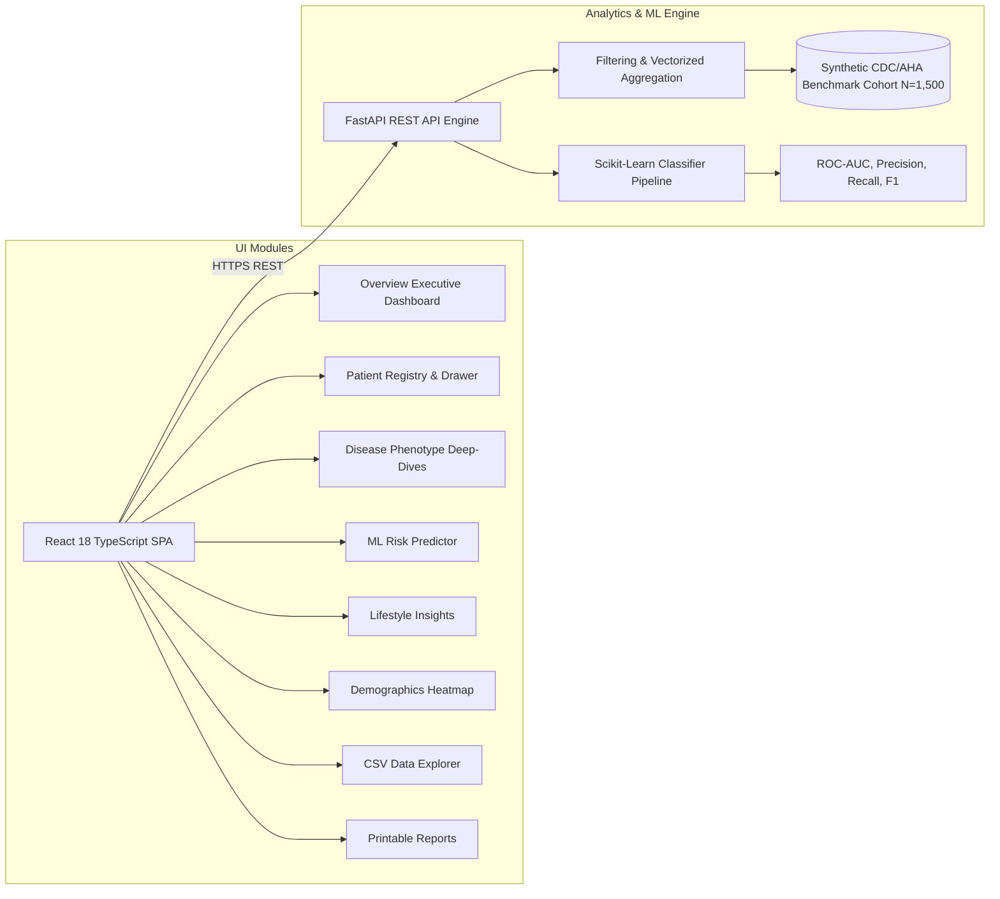

# Health360 — Comprehensive Healthcare Risk & Disease Analytics

[](https://opensource.org/licenses/MIT)
[](https://react.dev/)
[](https://fastapi.tiangolo.com/)
[](https://scikit-learn.org/)
[](https://tailwindcss.com/)

> **A professional, full-stack healthcare analytics and epidemiological surveillance platform designed for exploring disease prevalence, clinical risk associations, demographic patterns, and modifiable lifestyle factors.**

* **Live Demo:** [https://health360-analytics.netlify.app](https://health360-analytics.netlify.app) *(Deployment Placeholder)*
* **API Backend:** [https://health360-api.onrender.com](https://health360-api.onrender.com) *(Deployment Placeholder)*
* **GitHub Repository:** [https://github.com/placeholder-org/health360-analytics](https://github.com/placeholder-org/health360-analytics) *(Repository Placeholder)*

---

## 1. Problem Statement

Cardiometabolic and cerebrovascular diseases—specifically **Heart Disease**, **Type 2 Diabetes**, and **Stroke**—remain leading causes of preventable morbidity and healthcare expenditure globally. Healthcare researchers, public health officials, and clinical administrators face critical barriers when analyzing patient populations:
- Fragmented, siloed patient registries that hinder multi-condition co-morbidity exploration.
- Black-box risk models that lack transparent feature attribution or clinical guardrails.
- Unreliable reporting of percentages that fail to distinguish missing data from negative diagnoses.
- Inaccessible data exploration tools that cannot safely validate and harmonize external CSV cohorts.

## 2. Proposed Solution: Health360

**Health360** bridges the gap between raw clinical epidemiology and intuitive healthcare intelligence. It provides:
1. **Interactive Population Surveillance:** 6 real-time executive KPI metrics, BMI class stratifications, age-stratified prevalence curves, and Pearson correlation heatmaps.
2. **Searchable Patient Registry:** A responsive clinical table with multi-parameter filtering, column sorting, pagination, and slide-out patient drawers.
3. **Validated Machine Learning Risk Engine:** Calibrated Scikit-Learn Random Forest models reporting ROC-AUC (0.77+), Accuracy (88%+), and F1-scores, supplemented with transparent feature attribution and population baseline comparisons.
4. **Dynamic Lifestyle Intelligence:** Algorithmic calculation of odds ratios and relative risk gradients across smoking, physical activity, and alcohol intake (no hardcoded statistics).
5. **Data Explorer & Schema Harmonization:** In-browser CSV cohort upload with server-side validation, duplicate detection, range checks, and descriptive statistics.
6. **Institutional Report Generator:** Customized exportable surveillance reports with browser PDF printing and automated data limitations disclosures.

---

## 3. Technology Stack

### Frontend
- **Framework:** React 18 with Vite (TypeScript)
- **Styling:** Tailwind CSS with custom healthcare palette (Navy, Teal, Cyan, Slate)
- **Charts:** Recharts (responsive SVG charts with custom tooltips) + Canvas/SVG gauges
- **Icons:** Lucide React
- **Deployment:** Netlify (with SPA redirect configuration)

### Backend
- **Framework:** Python 3.13 with FastAPI
- **Data Engine:** Pandas and NumPy for vectorized computation
- **Machine Learning:** Scikit-Learn (`RandomForestClassifier`, `StandardScaler`, Stratified K-Fold / Train-Test evaluation)
- **File Validation:** Python Multipart with sanitization & 10MB limits
- **Deployment:** Render / Docker-compatible web service

---

## 4. System Architecture



---

## 5. Dataset Description & Calibration

Health360 is pre-loaded with a high-fidelity synthetic benchmark cohort of **1,500 patient records** statistically calibrated to CDC NHANES, American Heart Association (AHA), and American Diabetes Association (ADA) epidemiological distributions:
- **Heart Disease Prevalence:** 12.3%
- **Diabetes Prevalence:** 23.4%
- **Stroke Prevalence:** 4.3%
- **Age Distribution:** 18 to 86 years (Mean: 50.8 years)
- **BMI Range:** 17.0 to 46.5 kg/m² across 6 standard WHO/CDC classes
- **Clinical Biomarkers:** Systolic BP, Diastolic BP, Total Cholesterol, Fasting Blood Glucose, Symptoms (Chest Pain, Fatigue, Dizziness), Lifestyle Behaviors (Smoking, Exercise Level, Alcohol Consumption)

> **De-Identification & Privacy Notice:** All records in the benchmark cohort are fully synthetic and contain zero Protected Health Information (PHI) or Personally Identifiable Information (PII).

---

## 6. Installation & Local Development

### Prerequisites
- **Node.js:** v18.0.0+ (Tested on v22.18.0)
- **npm:** v9.0.0+ (Tested on v10.9.3)
- **Python:** 3.10+ (Tested on 3.13.2)

### Step 1: Clone the Repository
```bash
git clone https://github.com/placeholder-org/health360-analytics.git
cd health360-analytics
```

### Step 2: Set Up Backend
```bash
cd backend

# Create virtual environment (optional but recommended)
python -m venv venv
# Windows:
venv\Scripts\activate
# macOS/Linux:
source venv/bin/activate

# Install dependencies
pip install -r requirements.txt

# Run backend development server
uvicorn app.main:app --host 0.0.0.0 --port 8000 --reload
```
The API documentation is accessible at `http://localhost:8000/docs`.

### Step 3: Set Up Frontend
```bash
cd ../frontend

# Install dependencies
npm install

# Start Vite development server
npm run dev
```
Open your browser to `http://localhost:5173`.

---

## 7. Environment Variables

### Frontend (`frontend/.env`)
```ini
VITE_API_BASE_URL=http://localhost:8000
```

### Backend (`backend/.env`)
```ini
PORT=8000
ALLOWED_ORIGINS=http://localhost:5173,http://127.0.0.1:5173
ENVIRONMENT=development
```

---

## 8. Verification & Testing

### Running Backend Unit Tests
```bash
cd backend
python -m unittest app/tests/test_api.py
```

### Building & Validating Frontend
```bash
cd frontend
npm run build
```

---

## 9. Deployment Guide

### Frontend Deployment (Netlify)
1. Link your GitHub repository to Netlify.
2. Set **Base directory:** `health360/frontend` (or `frontend`).
3. Set **Build command:** `npm run build`.
4. Set **Publish directory:** `dist`.
5. Set Environment Variable: `VITE_API_BASE_URL` to your production backend URL.
6. The included `public/_redirects` ensures seamless single-page application client-side routing.

### Backend Deployment (Render)
1. Create a new Web Service on Render linked to your repository.
2. Set **Root Directory:** `backend`.
3. Set **Runtime:** `Python 3`.
4. Set **Build Command:** `pip install -r requirements.txt`.
5. Set **Start Command:** `uvicorn app.main:app --host 0.0.0.0 --port $PORT`.
6. Add Environment Variable: `ALLOWED_ORIGINS=*` (or your Netlify frontend domain).

---

## 10. Screenshots

| Overview Dashboard | Patient Analytics Registry |
| :---: | :---: |
|  |  |

| Disease Phenotype Deep-Dive | ML Risk Predictor |
| :---: | :---: |
|  |  |

| Demographic Cohort Pyramids | Surveillance Report PDF |
| :---: | :---: |
|  |  |

*(Screenshots can be updated with high-resolution captures from live deployment).*

---

## 11. Methodological Limitations

- **Cross-Sectional Baseline:** The primary benchmark dataset represents cross-sectional observations; longitudinal causality cannot be confirmed without prospective cohort tracking.
- **Screening Indicator Bounds:** Body Mass Index (BMI) is an anthropometric screening indicator that does not assess visceral adiposity, muscle composition, or regional fat distribution.
- **Sample Size Thresholds:** Subgroups with fewer than 15 patients ($N < 15$) are flagged with low-sample warnings to discourage over-interpretation of statistical noise.

---

## 12. Healthcare & Regulatory Disclaimer

> **IMPORTANT MEDICAL NOTICE:**
> Health360 is an academic decision-support, epidemiological research, and educational demonstration prototype. It does not provide medical diagnoses, treatment recommendations, or clinical prescriptions. It has not been evaluated or approved by the U.S. Food and Drug Administration (FDA), European Medicines Agency (EMA), or any other medical regulatory authority. Always seek the advice of a qualified physician or healthcare provider regarding any medical condition.

---

## 13. License

Distributed under the MIT License. See `LICENSE` for details.
