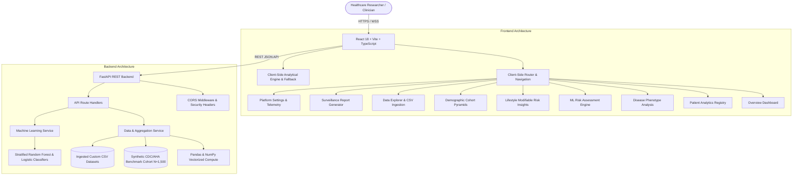

# Health360 System Architecture & Technical Specifications

Health360 is built as a modular, production-ready healthcare analytics platform designed for high-concurrency epidemiological surveillance, multi-disease risk factor exploration, and responsible clinical decision support.

## Key Architectural Principles

1. **Deterministic Separation of Concerns**:
   - The backend handles data parsing, type validation, statistical computation, stratification, and ML model fitting with proper train/test partitioning.
   - The frontend renders responsive, accessible visualizations using Recharts and Tailwind CSS with instant client-side fallback handling.

2. **Data Leakage Safeguards**:
   - Machine learning pipelines partition training and testing data using stratified 80/20 splits before applying StandardScaler and dummy variables, preventing test-set contamination.

3. **Responsible Clinical AI & Guardrails**:
   - Prevalence rates explicitly cite valid non-null denominators ($N_{valid}$).
   - Statistical correlations display mandatory notices stating that correlation does not establish causation.
   - Small demographic sub-cohorts ($N < 15$) are visually flagged with low-sample warnings.
   - All analytical screens include non-diagnostic educational disclaimers.
